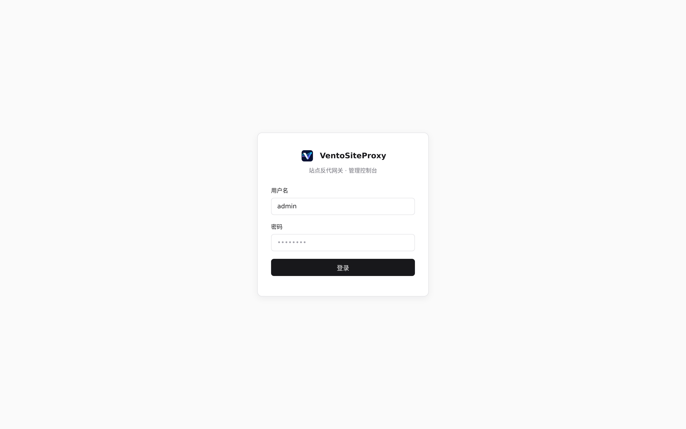
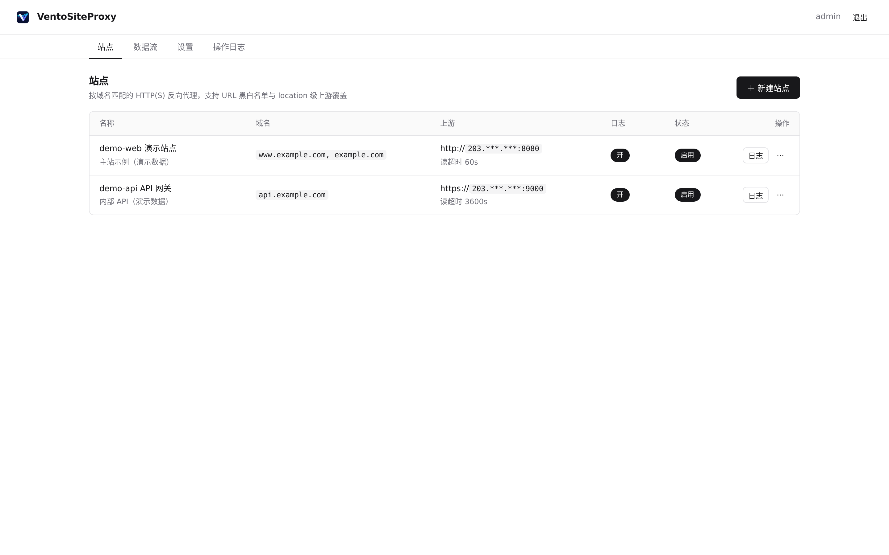
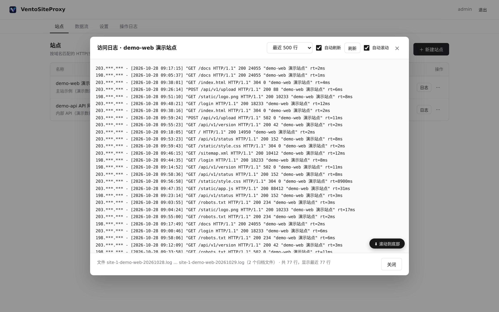
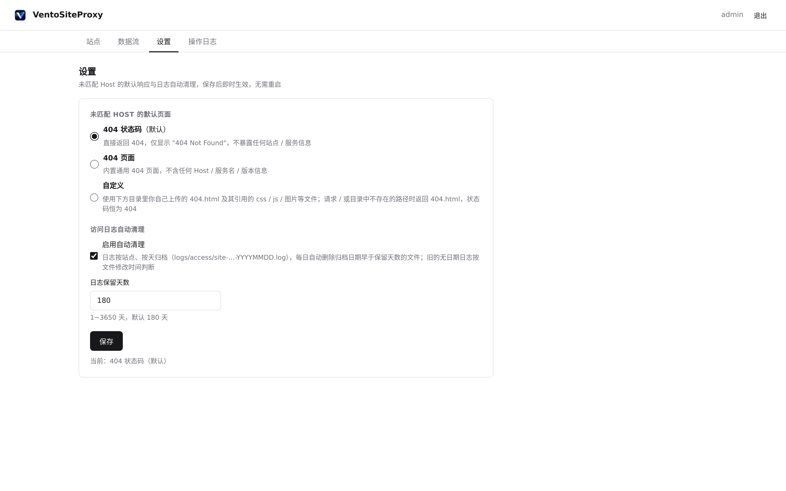
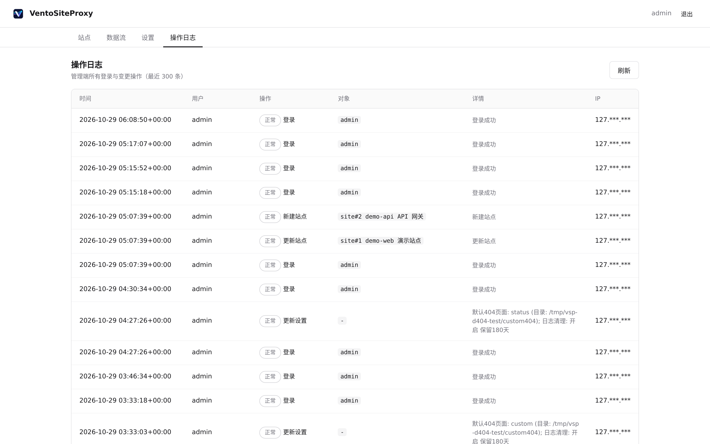

<p align="center"></p>

# VentoSiteProxy

基于 [Pingora](https://github.com/cloudflare/pingora) 的反代网关，替代 Nginx Proxy Manager：
**账号登录 · 反代站点配置 · 启用/禁用 · 操作日志 · 热重载（配置文件同步）**。

## 为什么是 Pingora

NPM 的痛点全部来自 nginx 默认配置，而 Pingora 是原生行为，无需任何 override：

| NPM 问题 | VentoSiteProxy |
|---|---|
| proxy_buffering 卡 SSE | 默认流式转发，无缓冲 |
| client_max_body_size 1m | 无 body 大小限制 |
| 长连接 60s 断开 | 超时 per-site 可配，`0` = 不限 |
| advanced config 复杂 | 配置模型即能力，管理端可视化 |

## 功能

- **站点（HTTP 反代）**：名称 / 备注 / 多域名（含 `*.wildcard`）/ 上游 http(s) / SNI / 证书校验开关 / 连接·读·写超时（秒，0=不限）
- **location 覆盖**：按序匹配 path，命中后覆盖上游（对应 NPM locations，如 `/mqtt*` 独立 broker + 7 天长超时）
- **URL 黑白名单**：按序匹配、首个命中生效
  - 黑名单模式（默认 `url_default: allow`）：`/api/v1/db*` deny 放前面 → `/api/v1/db`、`/api/v1/db/health` 403，其余放行
  - 白名单模式（`url_default: deny`）：只放行列出的 allow 规则
- **每站点访问日志开关**：按站点、按天归档 `logs/access/site-{id}-{slug}-YYYYMMDD.log`（跨天自动换新文件）
- **访问日志自动清理**：默认开启、保留 180 天；后台任务每日按归档日期删除超期文件（旧格式无日期文件按 mtime 判断），「设置」页可开关 / 改保留天数，即时生效
- **可配置默认 404 页面**：请求 Host 未命中任何启用站点时按 `default_404` 响应（管理端「设置」页可改，即时生效）：
  - `status`（默认）只返回 404 状态码 + 最小文本
  - `page` 内置通用 404 页面（不含 Host / 服务名 / 版本，不暴露信息）
  - `custom` 用户目录 `custom_404_dir` 里的 404.html 等文件（支持 css / 图片引用，防目录穿越，状态码恒 404）
- **TCP 数据流**：透传中继（MQTT 等），启用/停用约 1 秒生效
- **管理端**：argon2id 密码 + JWT（HS256，12h）；操作日志（登录 + 全部增删改启停）JSONL
- **热重载**：管理端保存 = ArcSwap 即时生效 + 原子写回 `sites.yaml`；手工改文件 2 秒内自动生效（解析失败保留旧配置）
- **零停机发布**：`--upgrade` 经 upgrade socket 接管旧进程 FD
- **零信任认证（可选，按站点启用）**：本地用户 / LDAP + 双因子（TOTP 动态码、passkey 通行密钥）；会话制 SSO（一次登录，全部启用认证的站点免登）；站点级 ACL（允许用户/组，两者皆空 = 谁都不允许）；豁免路径 `exempt_paths`；持续评估（用户禁用 / 因子删除 / 策略变更即时生效）；**空闲超时免密重验证**（仅二次因子，无需密码，`reauth_idle_secs` 可配）；站点级 **上游 Host/Origin 改写**（`upstream_host`，适配按 Host 鉴权的上游）

## 界面预览

以下截图来自本地演示环境：站点、域名、日志流量均为虚构演示数据（IP 使用 RFC 5737 文档保留段），上游地址等敏感信息已打码。

**登录**



**站点列表**



**访问日志（自动刷新 · 自动滚动 · 滚动到底部 · 按天归档文件）**



**设置（未匹配 Host 的默认 404 + 访问日志自动清理）**



**操作日志**



## 目录布局（部署机）

```
/usr/local/bin/ventositeproxy        二进制
/opt/ventositeproxy/
  ventsitemproxy.yaml                主配置
  sites.yaml                         站点路由表（管理端自动同步）
  admin.yaml                         管理员认证
  auth.yaml                          认证配置（本地用户开关/LDAP/会话/空闲重验证）
  auth.db                            认证数据（本地用户/TOTP/passkey，SQLite，600）
  upgrade.sock / *.pid
  logs/access/site-*.log             访问日志（按站点、按天归档）
  logs/audit.jsonl                   操作日志（管理端操作）
  logs/auth.jsonl                    认证门禁判定日志（登录/MFA/401/重验证…）
```

监听：代理 `8880`，管理端 `8890`（frp 端口切换指向 8880 即接入）。

## 使用

```bash
# 1. 初始化管理员（生成随机密码）
ventositeproxy init -f admin.yaml

# 2. 从 NPM 迁移
ventositeproxy migrate -d /opt/nginx-proxy-manager/data/database.sqlite -o sites.yaml

# 3. 启动
ventositeproxy run -c ventsitemproxy.yaml

# 改密码
ventositeproxy set-password -f admin.yaml --new-password 'xxxx'
```

systemd：`deploy/ventositeproxy.service`（`systemctl enable --now ventositeproxy`）。

## 零信任认证（站点级，默认关）

在管理端站点编辑弹窗的「认证」区启用（或直接改 `sites.yaml` 的 `auth` 段），详见 `docs/zero-trust-design.md`。

### 登录与二次验证

- 访问受保护站点 → 302 到登录页 → 输入密码（第一因子）。
- 用户开启 `mfa_required` 且已有因子：进入 MFA 页，**TOTP 6 位码或 passkey 二选一**通过即签发会话 Cookie（`vsp_session`，HttpOnly，作用于所有代理域名 = 一次登录跨站点免登）。
- 用户开启 `mfa_required` 但**一个因子都没有**：登录强制进入注册页（TOTP 扫码或注册 passkey），完成其一才能进入，不可跳过。
- **空闲免密重验证**：会话空闲超过 `reauth_idle_secs`（`auth.yaml` 的 `session` 段，默认 1800s，`0` = 关闭）但未达空闲超时（默认 8h）时，再次访问不要求重输密码——浏览器 302 到 MFA 页做 passkey/TOTP 验证即恢复；API 请求返回 `401 {"error":"reauth_required","mfa_url":…}`。达到空闲/绝对超时（30 天）则完整重新登录。

### `/__auth/mfa` 页面（一个 URL，四种模式自动判定）

| 模式 | 进入方式 | 页面内容 |
|------|---------|---------|
| `verify` | 密码通过后跳转（带一次性 token） | TOTP 输入框 / 「使用通行密钥验证」。**无注册入口**（安全设计：防止只有口令的状态下自注册因子） |
| `reauth` | 会话空闲超时被门禁踢回（凭会话 Cookie） | 同 verify，免密码，验证成功后会话重置空闲计时、直接续用 |
| `enroll` | `mfa_required` 但零因子（带 token） | 【绑定 TOTP】二维码 + 首码确认 / 【注册 Passkey】，完成其一 |
| `manage` | 已登录且 MFA 级别满足（直接访问 `https://<站点>/__auth/mfa`） | 安全设置：绑定/重置 TOTP、passkey 列表（设备名/签发时间/最近使用）+「添加通行密钥」+ 逐条删除 |

### passkey（通行密钥）注意事项

- 凭据是**设备本地**的：哪台设备注册只能在该设备上验证（私钥存于该设备安全芯片）。想给新设备加 passkey，必须先以其他方式（手机 passkey 或 TOTP）登录，再进入 `manage` 模式（安全设置）「添加通行密钥」。
- 要求 HTTPS（或 localhost）+ 可注册域名；`rp.id` 自动取 eTLD+1（如 `egt-dsh.aihualing.com` → `aihualing.com`）。微信/钉钉等内置浏览器不支持 passkey，请用 Chrome/Edge/Safari 最新版。
- 所有因子都丢失且无法登录 → 管理端重置该用户密码（撤销全部会话），下次登录自动进入 `enroll` 重新绑定因子。

### 站点认证配置要点

- `auth.enabled: true` 启用；`allowed_users` / `allowed_groups` 为白名单（命中其一放行，**两者皆空 = 谁都不允许**）。
- `exempt_paths`（glob 列表）：命中的路径**完全不经过认证**直接透传上游。浏览器自动请求的公开资源——PWA `/manifest.webmanifest`、`/favicon.svg`、`/favicon.ico`、健康检查 `/health*` 等——应加入，否则浏览器控制台会出现 401。
- `upstream_host`：非空时转发到上游前改写 `Host` 头（`Origin` 存在则同步改写为 `{scheme}://{upstream_host}`）；用于上游按 Host 鉴权、或反代隧道/内网地址与对外域名不一致的场景，否则上游会 401/403。留空 = 透传浏览器原始 Host。

## API 概览（管理端 :8890）

```
POST /api/login                    {username, password} → {token}
GET  /api/me
GET  /api/sites /api/sites/{id}
POST /api/sites                    新建
PUT  /api/sites/{id}               整体更新
DELETE /api/sites/{id}
POST /api/sites/{id}/enable|disable
GET  /api/streams /api/streams/{id}   POST/PUT/DELETE 同上
POST /api/streams/{id}/enable|disable
GET  /api/audit?limit=200
GET  /api/settings           全局设置（默认 404 页面模式 + 日志自动清理）
PUT  /api/settings           {default_404, custom_404_dir?, log_cleanup: {enabled?, retention_days?}}
```

请求头：`Authorization: Bearer <token>`。

## 零信任认证用法（终端用户侧）

### 登录与二次验证

- **首次登录**：`GET /__auth/login` 打开登录页 → 输密码 → 若用户开启 `mfa_required`：
  - 已有因子（TOTP 或 passkey 任一）→ 自动跳到二次验证页，输 TOTP 6 位码或用 passkey 验证，完成后签发会话 Cookie（`vsp_session`，HttpOnly，作用于所有代理域名 = 跨站点 SSO）；
  - 尚无因子 → 进入注册页，必须完成 TOTP 扫码或 passkey 注册其一才能继续（不可跳过）；
  - 未开启 `mfa_required` 的用户密码通过即直接登录。
- **空闲后免密重验证**：会话空闲超过 `reauth_idle_secs`（默认 1800s，`auth.yaml` 的 `session` 段可配，`0` = 关闭）但未达空闲超时（默认 8h）时，再次访问**不要求重新输密码**——浏览器 302 到 `/__auth/mfa` 做 passkey/TOTP 二次验证即恢复会话；API 请求返回 401 `{"error":"reauth_required","mfa_url":...}`。达到空闲/绝对超时则整会话失效，回完整登录页。
- 无因子且 `mfa_required` 的用户无法登录：只能由管理端重置密码后走 enroll 注册因子，或临时把该用户 `mfa_required` 置关。

### `/__auth/mfa` 页面四种模式（同一路径自动判定）

| 模式 | 进入条件 | 页面上有什么 |
|---|---|---|
| `verify` | 密码已通过、待第二因子（登录流，带 `?token=`） | TOTP 输入框 / 「使用通行密钥验证」（有 passkey 时）。**无注册入口**（防口令窃取者自注册因子） |
| `reauth` | 已登录会话空闲超时被门禁踢回（无 `token` 参数，走 Cookie） | 与 verify 相同，验证成功后 `touch` 会话直接续用，无需重登 |
| `enroll` | `mfa_required` 但一个因子都没有 | 注册页：【绑定 TOTP】二维码 + 首次验证码 / 【注册 Passkey】（指纹/面容/Windows Hello） |
| `manage` | 已登录且 MFA 级别满足（= 安全设置页，用户直接访问） | 绑定/重置 TOTP、passkey 列表（含设备名、签发时间、最近使用）+「添加通行密钥」+ 逐条删除 |

注意：verify/reauth 与 manage 的差别就是「有没有已验证的会话」；想给电脑加 passkey 必须先以其他方式（手机 passkey 或 TOTP）登录，然后从 manage 模式添加。passkey 是设备本地凭据，A 设备上注册的在 B 设备用不了。

### 站点 ACL 与豁免路径

- 站点 `auth.exempt_paths`（glob）：命中的路径**完全不经过认证**直接透传上游——登录页静态资源、健康检查、PWA manifest（`/manifest.webmanifest`）、favicon 等浏览器自动请求的公开资源都应加入；上游不存在的豁免路径会原样返回上游 404（属正常）。
- `allowed_users` / `allowed_groups`：白名单，登录用户须命中其一；**两者皆空 = 谁都不允许**（403「无权访问此站点」，审计 `access_denied_acl`）。

### 上游 Host/Origin 改写（`upstream_host`）

站点配置 `upstream_host`（如 `192.168.202.87:3080`）后，转发到上游时改写 `Host` 头（`Origin` 存在时同步改写为 `{scheme}://{upstream_host}`）；留空则透传浏览器原始 Host。用于：上游按 Host 鉴权、或反代隧道/内网地址与对外域名不一致的场景（否则上游 401/403）。管理端站点弹窗「上游 Host 头」字段可改。

## 构建

```bash
cargo build --release      # x86_64 Linux；rusqlite 为 bundled 编译（仅需 cc）
cargo test                 # glob 匹配 / 路由匹配单测
```

release profile：`opt-level=3, lto=true, codegen-units=1, strip=symbols`。
